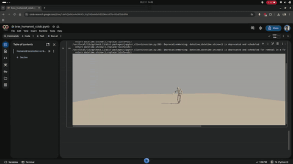
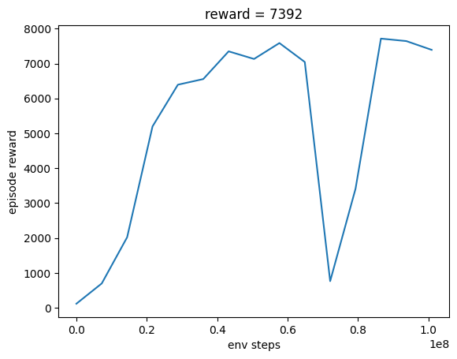

# Cloud GPU training — Brax on Colab

GPU-accelerated humanoid locomotion, as a counterpart to the CPU Stable-Baselines3 runs in `rl/`.

## Result (measured)

| | |
|---|---|
| GPU | Colab Pro **Tesla T4** (15 GB) |
| Engine | Brax (JAX, GPU-vectorized), 2,048 parallel envs |
| Steps | 100,000,000 |
| Wall-clock | **1h37m58s** |
| Final reward | **≈ 7,392** (peak ~7,700) |
| Outcome | humanoid stands and walks |

For contrast, the CPU SAC run in `rl/` took ~21 h for a stable gait. The GPU-vectorized
simulator is the difference — thousands of humanoids stepped in parallel on one device.

## Run it

Open `brax_humanoid_colab.ipynb` in Colab (File → Upload notebook), set **Runtime → GPU**, then:

1. Run `!nvidia-smi` (confirm a GPU).
2. Run the install cell, then **Runtime → Restart session**.
3. Run imports → train (~1.5–2 h on a T4 for 100M steps; checkpoints via `num_evals`).
4. Save params, then render/export the video (see the notebook's step 5).

The trained policy for this run is included: `humanoid_brax_params` (1.3 MB). The render cell
reloads it, so you can regenerate the video without retraining.

## The stability dial

`ctrl_cost_weight` controls action-magnitude penalty, and it is the key knob:

- **Too high (0.5–0.8):** the humanoid becomes timid — it can't make the vigorous corrective
  movements that balance requires, so it crouches (hunched posture) and falls within seconds.
- **Low (0.1, default):** it's free to act, stays upright for full episodes, and recovers.

So for a *stable* humanoid, keep `ctrl_cost_weight` low. (Smoothness and stability pull in
opposite directions here.) To make it stand *taller*, the stock reward isn't enough — you'd add a
custom uprightness term (torso height + tilt penalty) by subclassing the Brax humanoid env.

## Gotchas (hard-won)

- **Version pins are mandatory.** Legacy Brax is unmaintained and calls JAX APIs removed in
  JAX ≥0.11 (`get_opaque_trace_state`, `device_put_replicated`). On Colab (Python 3.13) the only
  combination that trains is `jax[cuda12]==0.4.38` + `jaxlib==0.4.38` + `brax==0.12.1`. Bare
  `pip install brax` pulls brax 0.14.2, which *forces JAX up* into the broken range — pinning
  **both** is what works.
- **Restart after the pinned install**, or the downgraded JAX won't load.
- **Dirty runtime = plugin errors.** If you've already run other JAX installs, a leftover CUDA
  plugin (`jax_cuda13_plugin`) mismatches the pinned `jaxlib` ("PJRT_Api already exists" /
  "Unable to initialize backend 'cuda'"). Fix: **Runtime → Disconnect and delete runtime** (full
  wipe, not just restart), then the clean pinned install.
- **Headless rendering needs EGL.** Colab has no display, so set `os.environ["MUJOCO_GL"]="egl"`
  *before any import* (MuJoCo caches its GL backend at import). For the render step, `JAX_PLATFORMS=cpu`
  avoids GPU/plugin contention — the 500-step rollout is cheap on CPU while EGL renders on the GPU.
- **No-retrain reload.** After a restart, rebuild the policy from saved params with
  `ppo_networks.make_ppo_networks(..., preprocess_observations_fn=running_statistics.normalize)` +
  `make_inference_fn(params)` — no need to retrain just to render.

## Background — why Brax

Google's **Brax** is a fast, JAX-based, fully differentiable rigid-body physics engine built to
accelerate RL on hardware accelerators (GPU/TPU):

- **Massive parallelism** — thousands of environments on a single GPU/TPU with no cluster setup,
  cutting training from hours toward minutes. (In practice here: ~1.5 h on a *free-tier* T4 for
  100M steps — the "minutes" figure is the TPU/A100 best case, but this is still a huge win over
  the ~21 h CPU run.)
- **Differentiable physics** — supports gradient-based optimization and standard RL algorithms
  (PPO, SAC, ES). **Caveat learned here:** Brax's own PPO *trainer* is version-fragile against
  current JAX, hence the pins above.
- **MuJoCo (MJX) integration** — Brax recommends **MJX** (`pip install mujoco_mjx`) or
  **MuJoCo Playground** for higher-fidelity physics on complex systems like humanoids. That is the
  maintained path and the natural next step from this notebook — the deprecation warning Brax
  prints points there directly.
- **Research use** — Brax/MJX are used to train high-DoF humanoid and robot policies
  (velocity-based locomotion, balance tasks) at scale.

## Next

- Move to **MJX / MuJoCo Playground** — maintained for current JAX, won't rot like legacy Brax.
- Add a custom **uprightness reward** for a taller, more natural gait.
- Add **perturbation (push) training** for genuine balance recovery.
