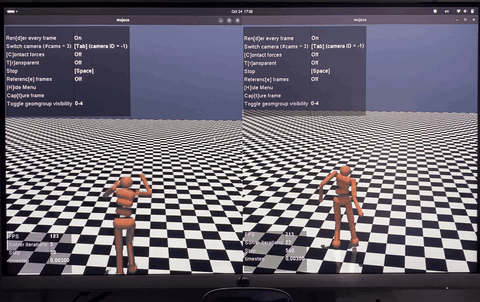

# pai-robotics-lab

A reproducible **physical-AI / robotics workstation** built from a bare Ubuntu 24.04 laptop: swarm simulation, reinforcement-learning locomotion, and edge-AI inference across CPU / iGPU / NPU — all running locally on an Intel Meteor Lake machine with **no NVIDIA GPU**.



*Same MuJoCo `Humanoid-v5` task, two algorithms. **Left (PPO):** a fast but forward-pitched, hunched lope that covers ground by falling forward productively. **Right (SAC):** an upright, arms-out, balance-first gait that stays composed for full episodes. See [docs/results.md](docs/results.md).*

---

## What this is

A single-session build-out of a full local robotics stack, captured as scripts and demos so it can be reproduced or extended. Three pillars:

| Pillar | Tools | What runs locally |
|---|---|---|
| **Swarm simulation** | ARGoS3 + Buzz | Multi-robot flocking (foot-bots, Lennard-Jones) |
| **RL locomotion** | MuJoCo, Gymnasium, Stable-Baselines3 | PPO & SAC training + viewers (HalfCheetah, Humanoid) |
| **Edge AI** | OpenVINO, Ultralytics/YOLOv11 | Inference on CPU + Intel Arc iGPU + Meteor Lake NPU |

### Built and tested on

- **Machine:** HUAWEI ENZH-XX — Intel® Core™ Ultra 5 125H (Meteor Lake, 14C/18T), Intel® Arc™ iGPU, 32 GB RAM, 1 TB
- **OS:** Ubuntu 24.04 LTS (Noble), Wayland/GNOME
- **Accelerators:** OpenVINO sees `['CPU', 'GPU', 'NPU']` (Intel NPU driver v1.38, kobuk-team intel-graphics PPA)
- **No CUDA by design** — Isaac Sim/Lab and large-scale GPU RL belong on a separate GPU box or the cloud.

---

## Results (headline)

Humanoid-v5, trained entirely on the CPU of the machine above:

| Run | Algorithm | Reward (ep_rew_mean) | Episode length | Wall-clock |
|---|---|---:|---:|---:|
| 1 | PPO (default net `[64,64]`) | ~920 | ~180 | ~11 min / 1 M steps |
| 2 | PPO (tuned, net `[256,256]`) | ~2,900 | ~310 | ~2h40 / 15 M steps |
| 3 | **SAC** | **~5,500** | **~980** | ~21 h / 3 M steps |

A stable walker sits at ep_len ≈ 1000 and reward ≈ 5,000–6,000 — **SAC gets there**; PPO plateaus. Full write-up and per-algorithm gait analysis in [docs/results.md](docs/results.md).

(Sanity-check env first: HalfCheetah-v5 PPO climbs from ~−330 to ~+1,080 in ~11 minutes — a fast loop to confirm the pipeline before committing hours to Humanoid.)

---

## Repo layout

```
pai-robotics-lab/
├── setup/
│   └── setup_robotics.sh      # modular installer (base / argos / pyenv / edge)
├── rl/                        # reinforcement-learning locomotion
│   ├── train_ppo.py           # tuned PPO (SB3-zoo Humanoid recipe)
│   ├── watch_ppo.py           # render a trained PPO policy
│   ├── train_sac.py           # SAC — the stable-walker recipe
│   ├── watch_sac.py           # render a trained SAC policy
│   └── README.md
├── swarm/                     # ARGoS3 + Buzz swarm demo
│   ├── flocking.bzz           # Lennard-Jones flocking controller
│   ├── flocking.argos         # 20 foot-bots, 2D dynamics, QtOpenGL
│   └── README.md
├── edge/                      # OpenVINO edge-AI on CPU / iGPU / NPU
│   ├── check_devices.py       # list OpenVINO devices + names
│   ├── benchmark_yolo_openvino.py  # YOLOv11n latency: CPU vs GPU vs NPU
│   └── README.md
├── docs/
│   └── results.md             # full results + gait analysis
├── assets/                    # README media (GIF, stills)
├── requirements.txt
├── setup/setup_robotics.sh
├── .gitignore
└── LICENSE
```

---

## Quickstart

```bash
git clone https://github.com/gtfrans2re/pai-robotics-lab.git
cd pai-robotics-lab

# 1. System deps + accelerators (modular; run as your normal user, not root)
chmod +x setup/setup_robotics.sh
./setup/setup_robotics.sh base pyenv edge      # add 'argos' for the swarm sim

# 2. Activate the Python env
source ~/pai-robotics-venv/bin/activate

# 3. Confirm the accelerators
python edge/check_devices.py                   # expect: ['CPU', 'GPU', 'NPU']
```

### Reinforcement learning

```bash
cd rl
python train_sac.py                            # trains Humanoid-v5 (overnight on CPU)
python watch_sac.py                            # render the final policy
python watch_sac.py models/Humanoid-sac_1000000_steps.zip   # a mid-run checkpoint
```

### Swarm simulation (requires the `argos` module)

```bash
cd swarm
bzzc -I /usr/local/share/buzz/include -b flocking.bo -d flocking.bdbg flocking.bzz
argos3 -c flocking.argos                        # hit ▶ in the QtOpenGL window
```

### Edge AI

```bash
python edge/benchmark_yolo_openvino.py          # YOLOv11n latency across CPU/GPU/NPU
```

---

## Notes & gotchas (hard-won)

These tripped the original build; the scripts handle them, but worth knowing:

- **Intel NPU in OpenVINO:** the Canonical `intel-npu-driver` **snap** self-tests fine but is confined, so pip-installed OpenVINO (which reads the *system* Level-Zero loader) can't see the NPU through it. The fix is the **`.deb` driver** from `intel/linux-npu-driver` releases, which lands on the system library path. `setup_robotics.sh edge` uses the `.deb` path.
- **ARGoS3 build:** `make install` can fail on missing *documentation* artifacts (`argos3.1.gz`, `doc/api/standalone`, `README.html`) even after a 100%-clean compile. Build the doc toolchain (`asciidoc xmlto docbook-xml docbook-xsl xsltproc`) and/or pass `-DARGOS_DOCUMENTATION=OFF`. The installer does this.
- **Buzz compile:** `bzzc` needs `-I /usr/local/share/buzz/include` to find `vec2.bzz`; its argument form is flag-based (`-b out.bo -d out.bdbg in.bzz`), not positional.
- **MuJoCo viewer on Wayland:** if the window fails with a GLFW/EGL error, prepend `MUJOCO_GL=egl` (or `glx`).
- **Torch pulls CUDA wheels:** `ultralytics` drags in ~4–5 GB of `nvidia-*` wheels that never load on Intel. For a lean env: `pip uninstall -y torch torchvision && pip install torch torchvision --index-url https://download.pytorch.org/whl/cpu`.
- **SAC on CPU is slow:** it does a gradient update every env step (~40 fps here), so 3 M steps is an **overnight** run. PPO is ~1,500 fps but caps lower on Humanoid.

---

## Roadmap

- **Faster + stable gait:** reward-shaping on `Humanoid-v5` (raise forward-velocity weight / lower control cost) — SAC is stable but conservative on speed.
- **Policy → OpenVINO:** export a trained SB3 policy and run it on the NPU/iGPU — bridges the RL and edge-AI halves.
- **Swarm RL:** bring PPO/SAC to a multi-robot ARGoS task.
- **Sim-to-real:** quantized policy / YOLO on a Raspberry Pi 4 with the laptop as ground station.

---

## Acknowledgements

Built on [ARGoS3](https://www.argos-sim.info/), [Buzz](https://the.swarming.buzz/), [MuJoCo](https://mujoco.org/), [Gymnasium](https://gymnasium.farama.org/), [Stable-Baselines3](https://stable-baselines3.readthedocs.io/), [Ultralytics YOLO](https://docs.ultralytics.com/), and [Intel OpenVINO](https://docs.openvino.ai/).

## License

MIT — see [LICENSE](LICENSE).

## Author

**Francois Gonothi Toure** — GitHub [@gtfrans2re](https://github.com/gtfrans2re)
